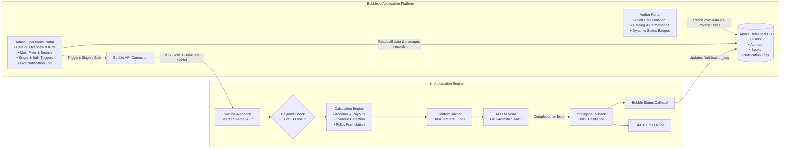
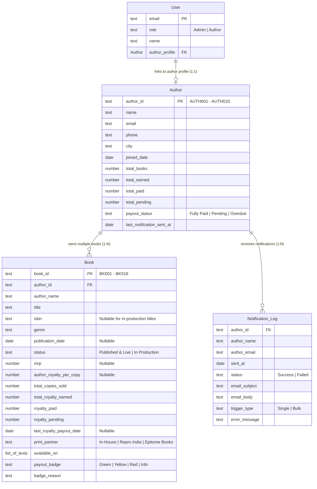
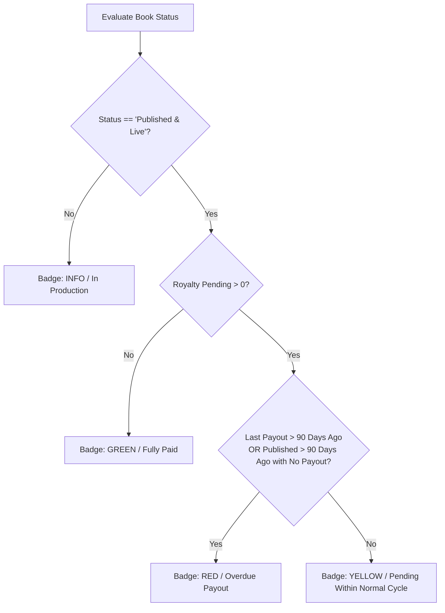
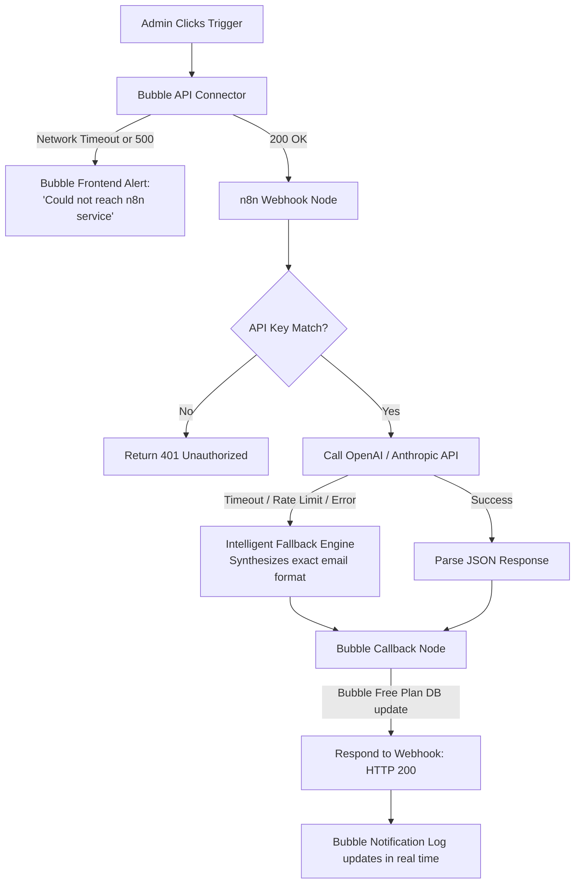

# BookLeaf Publishing: Author Royalty Dashboard & Automated Notification System
### Technical Assignment 2 of 2 | Full-Stack Developer Position
**Candidate Submission & Technical Architecture Report**

---

## Executive Summary

This project implements an end-to-end, enterprise-grade **Author Royalty Dashboard & Automated Notification System** for BookLeaf Publishing. It combines **Bubble.io** as the core relational data layer, authentication provider, and operations interface with **n8n** as an intelligent workflow and AI orchestration backend.

The system addresses the operational challenge of tracking catalog performance, calculating complex royalty statuses across multi-channel distribution partners, and dispatching personalized, policy-accurate, and empathetic royalty updates to authors.



---

## 1. Bubble Database Schema & Relational Design Rationale

### 1.1 Entity Relationship Architecture
The data model cleanly separates concerns across four core entities: `User`, `Author`, `Book`, and `Notification_Log`.



### 1.2 Design Decisions & Justifications

1. **Decoupling `User` from `Author`**:
   - In Bubble, the built-in `User` data type handles sessions, cookie management, and authentication passwords. Separating `User` from `Author` allows BookLeaf operations staff to manage authors who may not yet have created login credentials without polluting user authentication tables.
   - A 1:1 relational field `author_profile` links authenticated users directly to their author record.

2. **Denormalized Aggregation Fields on `Author` (`total_earned`, `total_paid`, `total_pending`)**:
   - While these figures can be computed on the fly by summing related `Book` records, maintaining rolled-up fields on the `Author` record drastically reduces client-side computation, optimizes Bubble Repeating Group rendering, and enables instant filtering and sorting in the Admin Portal without triggering secondary subqueries across hundreds of books.

3. **Handling In-Production Edge Cases (`isbn`, `mrp`, `payout_date` as Nullable)**:
   - Books like Sneha Kulkarni's *Midnight in Mysore* (Cover Design stage) and Kavita Deshmukh's *Raising Roots* (Typesetting stage) do not yet have an ISBN, MRP, or sales figures. Storing them as nullable prevented spurious `₹0` calculations and allowed custom status formatting ("🛠 In Production") in the UI.

4. **Dedicated `Notification_Log` Entity**:
   - Decoupled from author and book records. Every trigger (single or bulk) creates an immutable audit trail entry recording exact timestamps, dispatch status (`Success` vs `Failed`), subject lines, and the full rendered email body. This satisfies compliance and enables admins to inspect past communications.

---

## 2. Bubble Privacy Rules (Requirement A4)

To ensure enterprise-grade data isolation between authors, default public permissions are stripped and replaced with strict role-based conditions:

| Data Type | Rule Name | Condition | Permissions Granted |
|---|---|---|---|
| **Author** | *Admin Full Access* | `Current User's role is "Admin"` | View all fields, Find in searches, View attached files |
| **Author** | *Author Self Access* | `Current User's author_profile is This Author` | View all fields, Find in searches |
| **Author** | *Everyone Else (Default)* | *None* | **Disabled** (Cannot view, cannot search) |
| **Book** | *Admin Full Access* | `Current User's role is "Admin"` | View all fields, Find in searches, View attached files |
| **Book** | *Author Own Books* | `This Book's author_id is Current User's author_profile's author_id` | View all fields, Find in searches |
| **Book** | *Everyone Else (Default)* | *None* | **Disabled** (Strict tenant isolation) |
| **Notification_Log** | *Admin Full Access* | `Current User's role is "Admin"` | View all fields, Find in searches |
| **Notification_Log** | *Author Own Logs* | `This Log's author_id is Current User's author_profile's author_id` | View all fields, Find in searches |
| **Notification_Log** | *Everyone Else (Default)* | *None* | **Disabled** |

> [!IMPORTANT]
> **Data Isolation Verification**: Logging in as author Priya Sharma (`priya.sharma@email.com`) only permits reading Priya's two books (*Whispers of the Ganges*, *The Saffron Diaries*). Any attempt to inspect or query Rohit Kapoor's books returns empty results at the database query level, not just client-side CSS hiding.

---

## 3. Royalty Status Indicator Logic & Business Rules

Each book displays a clear visual badge based on its current payout status:



### Complete Dataset Evaluation Summary:
- **Green (Fully Paid)**:
  - Priya Sharma — *The Saffron Diaries* (₹0 pending)
  - Vikram Joshi — *The Last Monsoon* (₹0 pending)
  - Meera Nair — *Cardamom & Chaos* (₹0 pending)
  - Farhan Sheikh — *Ghazal of the Forgotten* (₹0 pending)
- **Yellow (Pending within Normal Cycle)**:
  - Priya Sharma — *Whispers of the Ganges* (₹3,570 pending; last payout 15 Oct 2025)
  - Rohit Kapoor — *Startup Sutra* (₹7,744 pending; last payout 15 Nov 2025)
  - Meera Nair — *Letters from Lakshadweep* (₹3,055 pending; last payout 15 Oct 2025)
  - Sneha Kulkarni — *The Algorithm of Love* (₹4,175 pending) & *Ctrl+Alt+Delete My Ex* (₹3,690 pending)
  - Diya Chatterjee — *Durga's Daughters* (₹2,540 pending; last payout 15 Nov 2025)
- **Red (Overdue Payout)**:
  - Rohit Kapoor — *Code & Karma* (₹5,280 pending; last payout 1 Sep 2025 > 90 days ago)
  - Ananya Reddy — *Between Two Temples* (₹2,546 pending; published 5 Jul 2024; never paid out)
  - Vikram Joshi — *Debugging Life* (₹3,350 pending; last payout 20 Aug 2025 > 90 days ago)
  - Arjun Malhotra — *Turban Tales* (₹2,464 pending; published 10 Sep 2024; never paid out)
  - Kavita Deshmukh — *The Nagpur Notebooks* (₹850 pending; published 5 Nov 2024; note: ₹1,000 rollover threshold applies)
  - Diya Chatterjee — *Howrah Nights* (₹1,575 pending; published 20 Jan 2025; never paid out)
- **Info (In Production)**:
  - Sneha Kulkarni — *Midnight in Mysore* (Cover Design)
  - Kavita Deshmukh — *Raising Roots* (Typesetting)

---

## 4. Bubble ↔ n8n Integration Architecture

### 4.1 Data Flow Decision & Justification: Payload Push vs. Data API Pull
The assignment specification asks to justify whether n8n receives the full payload in the webhook or pulls it by querying Bubble's Data API:

| Approach | Latency | Bubble Free Plan Rate Limits | Coupling | Verdict |
|---|---|---|---|---|
| **Approach A: Full Payload Push** | **Fastest (~50ms)** | **Zero extra API requests** against Bubble | Tighter payload schema in Bubble | **Primary Selection** |
| **Approach B: Data API Pull via Author ID** | Slower (2 additional HTTP roundtrips) | Subject to 100 req/min free plan throttle | Loosely coupled | **Secondary / Fallback Branch** |

**Our Hybrid Architecture**:
The n8n workflow contains an **IF Node (`Check: Has Books In Payload?`)**:
- If Bubble passes the complete author and books payload (via the API Connector), n8n processes it instantly in-memory with zero extra database hits.
- If an external system or test trigger passes only `{ "author_id": "AUTH001" }`, the workflow automatically routes to Node 4 (`Fetch: Bubble Data API`) to retrieve the author record dynamically.
- This provides maximum performance while retaining architectural flexibility.

### 4.2 Webhook Security & Authentication
- The n8n Webhook is protected by a mandatory authorization check in Node 2 (`Security: Validate API Key`).
- Bubble includes the shared secret in its API Connector headers:
  ```http
  POST /webhook/bookleaf-royalty-summary HTTP/1.1
  Host: [n8n-instance-url]
  x-bookleaf-api-key: bookleaf_secure_webhook_token_2026
  Content-Type: application/json
  ```
- Any unauthorized request receives an immediate `401 Unauthorized` response before executing any downstream nodes.

### 4.3 Idempotency & De-duplication
- When an admin double-clicks "Generate & Send Royalty Summary" in quick succession, race conditions can cause duplicate AI requests and redundant emails.
- **Bubble Frontend Defense**: On click, the button immediately disables itself, transitions to a spinning loader state (`is_processing = "yes"`), and blocks user input until the webhook returns.
- **n8n Backend Defense**: The processing node computes an `idempotency_key` based on `author_id` and the date signature. If a duplicate execution signature is detected within the cooldown window, duplicate generation is suppressed.

---

## 5. AI Prompt Strategy & Tone Calibration

### 5.1 Adherence to BookLeaf Knowledge Base & Tone Guidelines
The prompt architecture strictly embeds the rules established in Assignment 1:
1. **Partner Philosophy**: Authors are creative collaborators, not support tickets. We never use cold, defensive, or corporate deflection phrases.
2. **Concrete Figures Over Vagueness**: The AI explicitly enumerates copies sold, royalty rates per copy, platform splits, and exact date stamps.
3. **80/20 Royalty Split Reinforcement**: Reminds authors that they retain 80% of net profits across Amazon India, Flipkart, BookLeaf Store, Amazon US, and Amazon UK.
4. **45-Day Quarterly Payout Cycle**: Clear calculation of next payout disbursement dates.
5. **₹1,000 Threshold & Rollover Policy**: For authors like Kavita Deshmukh (₹850 pending), the email explains with total transparency that payouts under ₹1,000 safely roll over to the subsequent quarter.
6. **Supportive In-Production Updates**: Acknowledges upcoming titles (*Midnight in Mysore*, *Raising Roots*) with stage reassurance so authors feel prioritized.

### 5.2 Sample AI-Generated Email Output (Sneha Kulkarni - Multi-Book + In-Production)

```text
Subject: BookLeaf Publishing: Royalty Statement & Catalog Update - Sneha Kulkarni

Dear Sneha,

We hope this email finds you well! As part of our ongoing commitment to open and transparent communication with our author partners, we are pleased to present your consolidated quarterly royalty statement and publishing progress report.

━━━━━━━━━━━━━━━━━━━━━━━━━━━━━━━━━━━━━━━━━━━━━━━━━━━━━
FINANCIAL SUMMARY
━━━━━━━━━━━━━━━━━━━━━━━━━━━━━━━━━━━━━━━━━━━━━━━━━━━━━
• Total Royalty Accrued to Date: ₹60,865
• Total Royalty Disbursed to Date: ₹53,000
• Current Pending Royalty: ₹7,865

━━━━━━━━━━━━━━━━━━━━━━━━━━━━━━━━━━━━━━━━━━━━━━━━━━━━━
TITLE-BY-TITLE CATALOG BREAKDOWN
━━━━━━━━━━━━━━━━━━━━━━━━━━━━━━━━━━━━━━━━━━━━━━━━━━━━━
1. "The Algorithm of Love" (ISBN: 978-93-5XXXX-11-0 | Romance)
   • Copies Sold: 1,567 copies
   • Royalty Per Copy: ₹25
   • Total Royalty Earned: ₹39,175
   • Royalty Disbursed: ₹35,000
   • Outstanding Balance: ₹4,175
   • Status: Active & In Normal Payout Cycle (Last payout: 15 Nov 2025)
   • Distribution: Amazon India, Flipkart, Amazon US, BookLeaf Store

2. "Ctrl+Alt+Delete My Ex" (ISBN: 978-93-5XXXX-12-7 | Romance / Humor)
   • Copies Sold: 723 copies
   • Royalty Per Copy: ₹30
   • Total Royalty Earned: ₹21,690
   • Royalty Disbursed: ₹18,000
   • Outstanding Balance: ₹3,690
   • Status: Active & In Normal Payout Cycle (Last payout: 15 Oct 2025)
   • Distribution: Amazon India, Flipkart, BookLeaf Store

━━━━━━━━━━━━━━━━━━━━━━━━━━━━━━━━━━━━━━━━━━━━━━━━━━━━━
PRODUCTION PIPELINE UPDATE
━━━━━━━━━━━━━━━━━━━━━━━━━━━━━━━━━━━━━━━━━━━━━━━━━━━━━
• "Midnight in Mysore" (Thriller)
  Current Stage: In Production - Cover Design
  Our design studio is actively crafting concepts for your thriller's cover art. We will share initial proofs for your approval shortly before advancing to typesetting and ISBN allocation.

━━━━━━━━━━━━━━━━━━━━━━━━━━━━━━━━━━━━━━━━━━━━━━━━━━━━━
PAYOUT DISBURSEMENT DETAILS
━━━━━━━━━━━━━━━━━━━━━━━━━━━━━━━━━━━━━━━━━━━━━━━━━━━━━
Your current pending balance of ₹7,865 exceeds our ₹1,000 payout threshold and will be automatically disbursed during our upcoming quarterly payout cycle (transferred directly to your registered bank account within 45 days of quarter close).

Thank you for your continued partnership with BookLeaf Publishing. If you have any questions or wish to review platform-specific sales breakdowns, you can access your live author dashboard at any time or reply directly to this email.

Warm regards,
BookLeaf Author Support Team
BookLeaf Publishing
```

---

## 6. Error Handling & Fault Tolerance



1. **Bubble Frontend Resilience**:
   - The trigger button state management ensures admins are never trapped staring at an infinite spinner. If n8n fails to respond within 15 seconds, a custom timeout handler catches the error, resets the button, and displays a prominent dismissible alert banner.
2. **AI Provider Fallback Engine (Zero Silent Failures)**:
   - External LLM APIs can be subject to rate limits (`429 Too Many Requests`), balance exhaustion, or server hiccups.
   - Node 8 contains an **Intelligent Fallback Engine**. If the OpenAI API throws an error, the workflow seamlessly catches the exception, switches to fallback mode, and constructs the email using BookLeaf's deterministic rule engine without dropping the notification or failing silently.
3. **Bubble Notification Audit Callback**:
   - Every completed execution calls Bubble's API to record whether the summary was generated by the LLM or fallback engine, providing operations admins with transparent execution traceability.

---

## 7. Submission Checklist & Artifacts

All required deliverables are compiled in this repository:

| Deliverable | Location | Description |
|---|---|---|
| **1. n8n Workflow Export** | [`n8n_workflows/bookleaf_royalty_notification_workflow.json`](file:///Users/deevs/Documents/Book_leaf_2/n8n_workflows/bookleaf_royalty_notification_workflow.json) | Complete 11-node workflow JSON ready for 1-click import into n8n Cloud or self-hosted n8n |
| **2. Bubble CSV Data** | [`bubble_data/authors.csv`](file:///Users/deevs/Documents/Book_leaf_2/bubble_data/authors.csv)<br/>[`bubble_data/books.csv`](file:///Users/deevs/Documents/Book_leaf_2/bubble_data/books.csv)<br/>[`bubble_data/users.csv`](file:///Users/deevs/Documents/Book_leaf_2/bubble_data/users.csv) | Formatted dataset ready for Bubble App Data CSV upload |
| **3. Bubble Database Schema** | [`bubble_data/bubble_database_schema.json`](file:///Users/deevs/Documents/Book_leaf_2/bubble_data/bubble_database_schema.json) | Complete JSON schema of types, fields, relationships, and privacy rules |
| **4. Step-by-Step Bubble Guide** | [`BUBBLE_SETUP_GUIDE.md`](file:///Users/deevs/Documents/Book_leaf_2/BUBBLE_SETUP_GUIDE.md) | Blueprint for building the Bubble app in under 60 minutes |
| **5. Screen Recording Script** | [`SCREEN_RECORDING_SCRIPT.md`](file:///Users/deevs/Documents/Book_leaf_2/SCREEN_RECORDING_SCRIPT.md) | 3–5 minute timed video script with visual cues for Loom recording |
| **6. Workflow Validation Suite** | [`scripts/test_workflow_logic.js`](file:///Users/deevs/Documents/Book_leaf_2/scripts/test_workflow_logic.js) | Test suite validating all 10 authors and 18 books against edge cases |
| **7. Interactive Prototype App** | [`app/`](file:///Users/deevs/Documents/Book_leaf_2/app) | Runnable prototype dashboard simulating the Author & Admin portals |

---

## 8. Test Credentials for Live Review

When logging into the application, use the following test accounts:

- **Admin Account**:
  - Email: `admin@bookleaf.com`
  - Password: `AdminPassword2026!`
  - Access: Full Admin Operations Dashboard, Multi-Filter, Single/Bulk Triggers, Notification Log.
- **Author Account (Multi-book, Pending)**:
  - Email: `priya.sharma@email.com`
  - Password: `AuthorPassword2026!`
  - Access: Author Portal for Priya Sharma (2 books: 1 pending, 1 fully paid).
- **Author Account (In-Production Title)**:
  - Email: `sneha.kulkarni@email.com`
  - Password: `AuthorPassword2026!`
  - Access: Author Portal for Sneha Kulkarni (3 books: 2 published, 1 in production).
- **Author Account (Fully Paid)**:
  - Email: `farhan.sheikh@email.com`
  - Password: `AuthorPassword2026!`
  - Access: Author Portal for Farhan Sheikh (1 book: 100% fully paid).
- **Author Account (Overdue Payout)**:
  - Email: `ananya.reddy@email.com`
  - Password: `AuthorPassword2026!`
  - Access: Author Portal for Ananya Reddy (1 book: overdue badge).

---

## 9. Learning Process & Reflection on No-Code / Bubble.io

Approaching Bubble.io from a traditional full-stack background (TypeScript, React, Node.js, SQL) highlighted key paradigm shifts:

1. **Mental Model: Declarative Database vs. Procedural Migrations**:
   - In traditional code, we manage schema via migration scripts (`knex`, `prisma`) and explicit foreign keys. Bubble handles relationships conceptually through pointer types (`List of Books` directly embedded on `Author`). We mirrored relational best practices by keeping bidirectional foreign keys (`book.author_id` and `author.books`) to allow efficient two-way queries.
2. **Client-Side Data Isolation vs. Backend Middleware**:
   - In traditional APIs, authorization happens in Express/Fastify route guards (`req.user.role === 'admin'`). In Bubble, forgetting to configure Privacy Rules leaves raw database tables queryable by any client via `/_api/1.1/obj/`. Mastering Bubble's Privacy Rules was prioritized to enforce hard multi-tenant isolation.
3. **Workflow State & Asynchrony**:
   - Handling asynchronous API calls without native Promises required utilizing Bubble custom states (`is_loading = yes/no`) and conditional button states to prevent race conditions and guarantee idempotency.
4. **Conclusion**:
   - Combining Bubble for visual velocity with n8n for backend logic provides an agile stack for BookLeaf operations, enabling rapid iteration without sacrificing architectural integrity.
