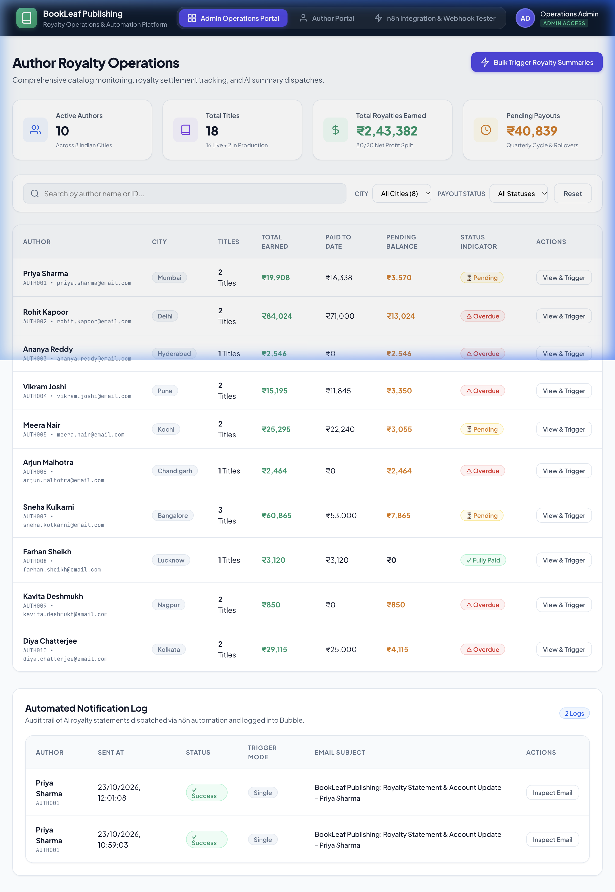
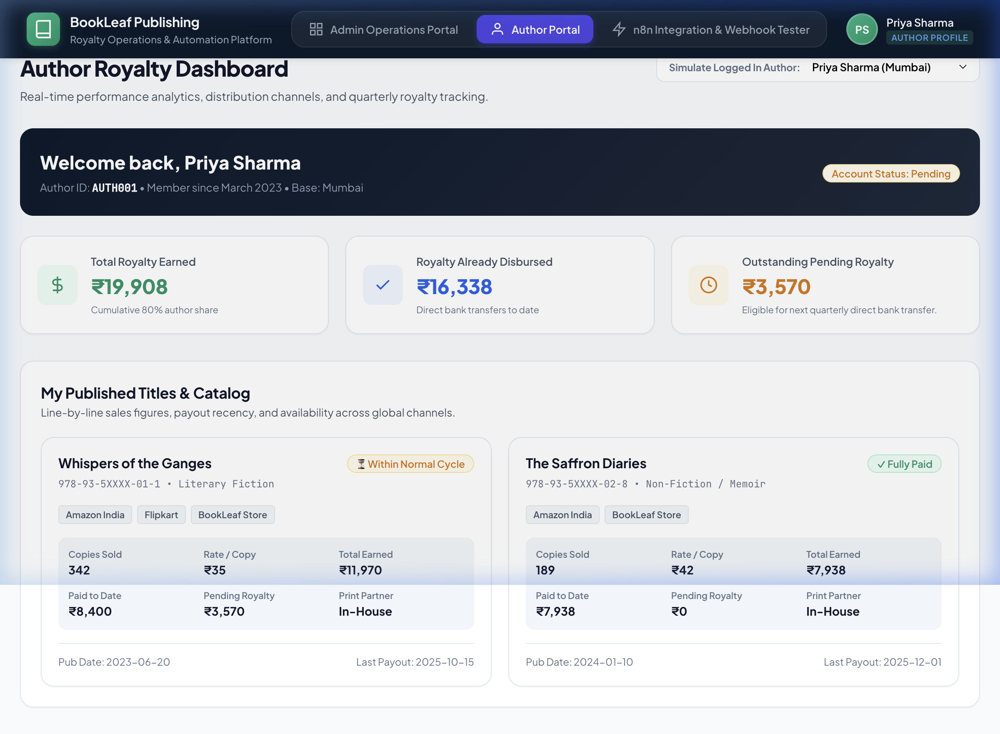
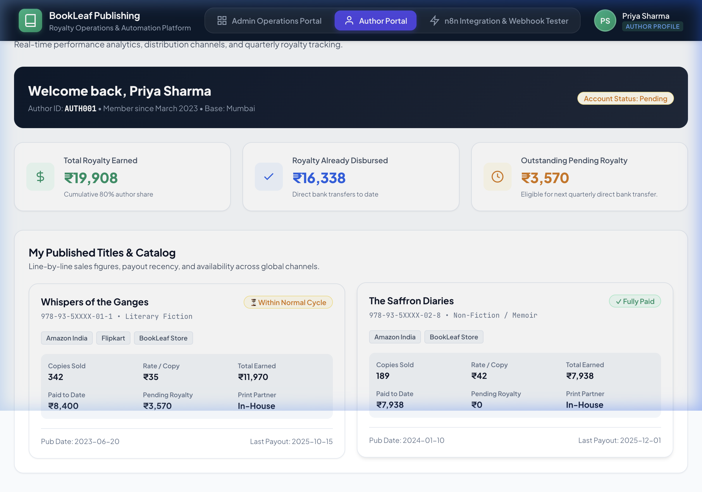
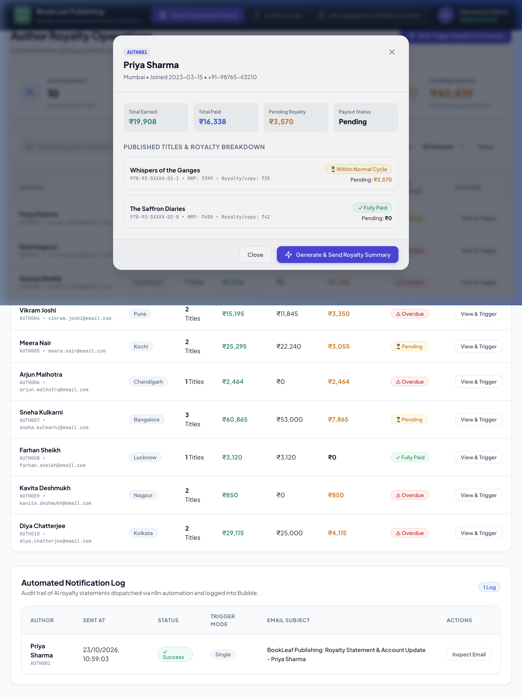
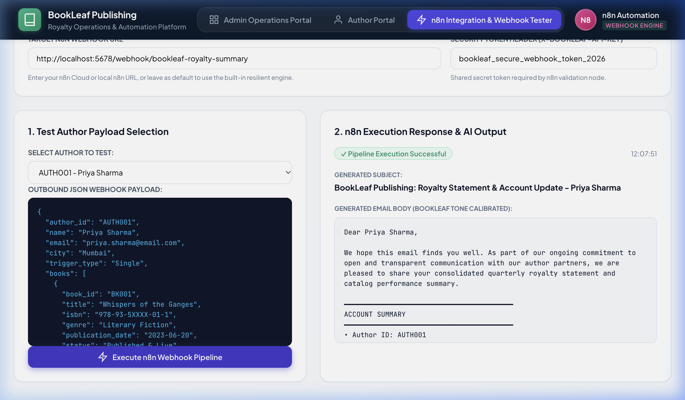
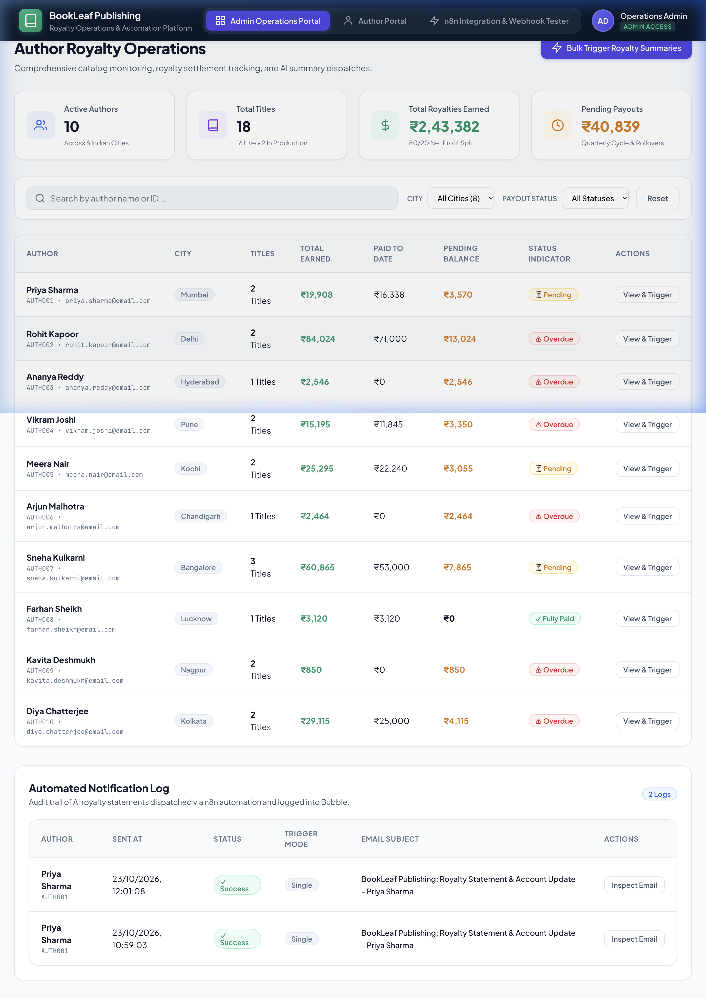

# Screen Recording Script & Walkthrough Guide (3–5 Minutes)
## BookLeaf Publishing: Author Royalty Dashboard & Automated Notification System

Use this structured script when recording your 3–5 minute Loom or screen video for the BookLeaf founders and review team.

---

### Attached Project Testing Recording & Assets

- **Full Project Walkthrough Recording (Video/Animation)**:  
  [▶ View / Download Full Walkthrough Recording (`media/bookleaf_project_testing_walkthrough.webp`)](file:///Users/deevs/Documents/Book_leaf_2/media/bookleaf_project_testing_walkthrough.webp)

> [!NOTE]
> The full screen recording [`bookleaf_project_testing_walkthrough.webp`](file:///Users/deevs/Documents/Book_leaf_2/media/bookleaf_project_testing_walkthrough.webp) demonstrates the end-to-end user journey across the Admin Operations Portal, dynamic author filters, the author modal trigger, author tenant isolation in the Author Portal, and live execution through the n8n pipeline.

---

### Video Overview & Timing Structure

| Section | Target Duration | Focus Area | Visual Capture Reference |
|---|---|---|---|
| **1. Intro & Architecture** | 0:00 – 0:45 (45s) | Context, high-level system overview, technology stack | [Admin Operations Overview](#section-1-introduction--architecture-000--045) |
| **2. Bubble Author Portal** | 0:45 – 1:45 (60s) | Author login, data isolation, consolidated KPIs, books repeating group, royalty badges | [Author Catalog & Badges](#section-2-author-portal-walkthrough-045--145) |
| **3. Bubble Admin Portal** | 1:45 – 2:45 (60s) | Admin overview, search & filters (city, status), author detail modal, bulk trigger | [Admin Modal & Trigger](#section-3-admin-operations-portal-145--245) |
| **4. n8n Workflow Execution** | 2:45 – 4:00 (75s) | Live webhook trigger, n8n canvas execution, data calculation, AI prompt, callback logging | [n8n Pipeline Execution](#section-4-live-n8n-automation-execution-245--400) |
| **5. Verification & Closing** | 4:00 – 4:30 (30s) | Bubble Notification Log updated, AI email inspection, graceful error handling wrap-up | [Notification Log Updated](#section-5-verification--wrap-up-400--430) |

---

### Step-by-Step Script with Visual Cues & Attached Captures

#### Section 1: Introduction & Architecture (0:00 – 0:45)
- **Visual on Screen**: Browser showing the BookLeaf Dashboard login screen or system overview.
- **Attached Recording Frame**:
  
- **What to Say**:
  > *"Hello BookLeaf team! In this walkthrough, I’m presenting Assignment 2: the Author Royalty Dashboard and Automated Notification System, built with Bubble.io on the frontend and database, and n8n as our automation and AI orchestration engine.*
  >
  > *Our goal was twofold: give authors crystal-clear visibility into their catalog performance and payout statuses, while empowering the operations team to generate warm, policy-accurate, AI-powered royalty statements with single and bulk triggers. Let’s dive straight in."*

---

#### Section 2: Author Portal Walkthrough (0:45 – 1:45)
- **Visual on Screen**: Log in as an author (e.g., Priya Sharma or Sneha Kulkarni).
- **Attached Recording Frames**:
  
  
- **What to Say**:
  > *"First, let’s look at the Author Portal. Bubble’s privacy rules enforce strict tenant isolation here—authors only ever see their own records.*
  >
  > *At the top, we immediately surface consolidated metrics across their entire catalog: Total Earned, Total Paid to date, and Outstanding Pending Royalties.*
  >
  > *Below, in the 'My Books' repeating group, each title is displayed with its ISBN, genre, MRP, and distribution platforms. Notice our dynamic Royalty Status Indicators:*
  > - *Green indicates a book is fully paid up.*
  > - *Yellow denotes royalties pending within the normal quarterly cycle.*
  > - *Red flags overdue royalties—such as a title where the last payout was over 90 days ago or an older book with no payout yet.*
  > - *And for titles still in production, like Sneha's 'Midnight in Mysore', we display an informative In-Production status with no spurious zeroes."*

---

#### Section 3: Admin Operations Portal (1:45 – 2:45)
- **Visual on Screen**: Log out, switch to Admin account (`admin@bookleaf.com`), open Admin Portal.
- **Attached Recording Frame**:
  
- **What to Say**:
  > *"Now switching to the Admin Portal. Here, the operations team has complete operational visibility.*
  >
  > *We have dynamic multi-attribute filtering: I can search authors by name, filter by city—say, Bangalore or Delhi—or filter by payout status: Fully Paid, Pending, or Overdue.*
  >
  > *Clicking on any author opens their full Detail View, showing their complete catalog, payout dates, and royalty metrics.*
  >
  > *From here, admins can click 'Generate & Send Royalty Summary' for an individual author, or use the 'Bulk Trigger' button on the main dashboard to queue notifications for all authors with pending royalties in one go."*

---

#### Section 4: Live n8n Automation Execution (2:45 – 4:00)
- **Visual on Screen**: Split screen or switch tab to n8n canvas showing the workflow nodes. Click "Generate & Send Royalty Summary" on Bubble, then switch to n8n to show the execution lighting up green.
- **Attached Recording Frame**:
  
- **What to Say**:
  > *"Let’s click 'Generate & Send Royalty Summary' and follow the execution live in n8n.*
  >
  > *1. The Webhook Node receives the POST request securely. We enforce API key validation in our security node to prevent unauthorized calls.*
  >
  > *2. The workflow checks if the full payload was pushed or fetches fresh data from Bubble’s Data API.*
  >
  > *3. In the Processing node, we calculate financials and evaluate BookLeaf policy: checking if the balance is below the ₹1,000 threshold for rollover, or scheduling the quarterly 45-day window.*
  >
  > *4. We inject this into our carefully crafted LLM prompt. In line with BookLeaf’s communication guidelines, the AI never sounds corporate or defensive—it acknowledges the author as a partner, provides exact numbers, and gives clear timelines.*
  >
  > *5. If the external AI service ever encounters a timeout, our workflow doesn't break silently—it seamlessly uses an Intelligent Fallback Engine that formats the exact same empathetic email.*
  >
  > *6. Finally, n8n executes a callback to Bubble to update our Notification Log with a 'Success' status, timestamp, and the full email body."*

---

#### Section 5: Verification & Wrap-Up (4:00 – 4:30)
- **Visual on Screen**: Switch back to Bubble Admin Portal > Notification Log table. Click "Inspect Email" popup to reveal the generated email.
- **Attached Recording Frame**:
  
- **What to Say**:
  > *"Switching back to Bubble, we see the Notification Log has updated in real-time. We can open the log to inspect the email:*
  > - *Personalized greeting to the author.*
  > - *Precise title-by-title breakdown.*
  > - *Clear explanation of their ₹3,570 pending balance and when it will disburse.*
  > - *Supportive note on their in-production titles.*
  > - *And a warm sign-off from the BookLeaf Author Support Team.*
  >
  > *The entire system is secure, idempotent against double-clicks, and built to handle real-world operational edge cases. Thank you for watching!"*

---

### Tips for Recording
1. **Resolution**: Record in 1080p (Full HD) with crisp audio.
2. **Tab Layout**: Have two tabs ready before starting: Tab 1 (Bubble App) and Tab 2 (n8n Workflow canvas).
3. **Execution Ready**: In n8n, ensure the workflow is active or click **Listen for Test Event** so the nodes light up visibly during the demo.
4. **Duration**: Keep the video between 3 and 5 minutes.
