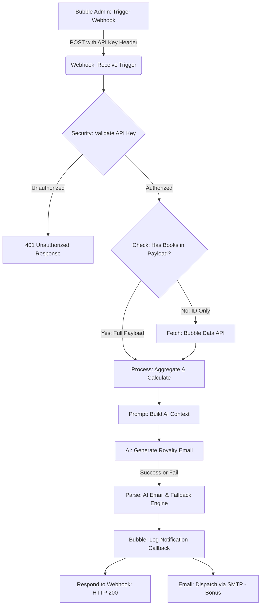

# n8n Workflow Technical Documentation: BookLeaf Royalty Notification System

This document provides a comprehensive technical walkthrough of the automated royalty statement and notification workflow exported in [`bookleaf_royalty_notification_workflow.json`](file:///Users/deevs/Documents/Book_leaf_2/n8n_workflows/bookleaf_royalty_notification_workflow.json).

---

## 1. Architectural Overview & Workflow Diagram

---

## 2. Node-by-Node Specification

### Node 1: `Webhook: Receive Trigger`
- **Type**: `n8n-nodes-base.webhook` (v2)
- **HTTP Method**: `POST`
- **Path**: `bookleaf-royalty-summary`
- **Response Mode**: `responseNode` (waits for the `Respond to Webhook` node to send back an informative JSON payload).
- **Purpose**: Acts as the incoming integration gateway listening for single author triggers or bulk trigger requests from Bubble.io.

### Node 2: `Security: Validate API Key`
- **Type**: `n8n-nodes-base.code` (JavaScript)
- **Security Mechanism**: Validates the shared secret token passed by Bubble in the HTTP headers (`x-bookleaf-api-key` or `Authorization: Bearer <secret>`).
- **Environment Variable**: Compares against `$env.BOOKLEAF_WEBHOOK_SECRET` (default: `bookleaf_secure_webhook_token_2026`).
- **Behavior**: Throws a `401 Unauthorized` exception if the header is missing or mismatched, preventing open or unauthorized triggering.

### Node 3: `Check: Has Books In Payload?`
- **Type**: `n8n-nodes-base.if` (v2)
- **Condition**: Checks if `payload.books` array exists.
- **Branching**:
  - **True Branch**: Fast path — uses the complete author payload sent directly from Bubble.
  - **False Branch**: Flexible fallback path — triggers Node 4 (`Fetch: Bubble Data API`) to retrieve the author record by ID.

### Node 4: `Fetch: Bubble Data API`
- **Type**: `n8n-nodes-base.httpRequest` (v4.2)
- **URL**: `{{ $env.BUBBLE_APP_URL }}/api/1.1/obj/author/{{ $json.payload.author_id }}`
- **Authentication**: Bearer Token (`$env.BUBBLE_API_TOKEN`)
- **Settings**: `continueOnFail: true`, 10-second timeout.

### Node 5: `Process: Aggregate & Calculate`
- **Type**: `n8n-nodes-base.code` (JavaScript)
- **Business Logic Performed**:
  1. Computes total royalty metrics: `totalEarned`, `totalPaid`, `totalPending`.
  2. Segregates catalog into `publishedBooks` and `inProductionBooks`.
  3. Evaluates royalty status badges for each book:
     - **Green (Fully Paid)**: `royalty_pending === 0`.
     - **Yellow (Pending within cycle)**: `royalty_pending > 0` and last payout/publication is within 90 days.
     - **Red (Overdue)**: `royalty_pending > 0` and last payout was >90 days ago, or no payout was ever made for a published book older than 90 days.
  4. Formulates policy context based on BookLeaf Knowledge Base:
     - **Zero pending**: Expresses positive acknowledgement of all accounts being settled.
     - **Below ₹1,000**: Explains the ₹1,000 minimum threshold and rollover to next quarter.
     - **Eligible pending**: Explains quarterly calculation and 45-day payout disbursement window.
  5. Generates idempotency signature (`idemp_<author_id>_<date>`).

### Node 6: `Prompt: Build AI Context`
- **Type**: `n8n-nodes-base.code` (JavaScript)
- **Purpose**: Constructs strict system prompt and contextual user prompt embedding BookLeaf's Communication Tone Guidelines (empathetic partner approach, transparent breakdowns, concrete numbers, clear next steps).

### Node 7: `AI: Generate Royalty Email`
- **Type**: `n8n-nodes-base.httpRequest` (v4.2)
- **Endpoint**: OpenAI Chat Completions API (`https://api.openai.com/v1/chat/completions`) or Anthropic API.
- **Model**: `gpt-4o-mini` (or configurable via `$env.OPENAI_MODEL`).
- **Settings**: `temperature: 0.3`, `response_format: { type: "json_object" }`, `continueOnFail: true`.

### Node 8: `Parse: AI Email & Fallback Engine`
- **Type**: `n8n-nodes-base.code` (JavaScript)
- **Fault-Tolerant Behavior**:
  - Parses the JSON output from the AI node.
  - **Intelligent Fallback**: If the AI API fails (rate limit, invalid API key, offline), automatically synthesizes an email matching BookLeaf's exact tone guidelines and metrics. The workflow never breaks silently!

### Node 9: `Bubble: Log Notification`
- **Type**: `n8n-nodes-base.httpRequest` (v4.2)
- **Endpoint**: `POST {{ $env.BUBBLE_APP_URL }}/api/1.1/obj/notification_log`
- **Payload Logged**:
  - `author_id`, `author_name`, `author_email`
  - `sent_at`: ISO timestamp
  - `status`: `"Success"` (or `"Failed"`)
  - `email_subject`, `email_body`
  - `trigger_type`: `"Single"` | `"Bulk"`
  - `error_message`

### Node 10: `Email: Dispatch (Bonus)`
- **Type**: `n8n-nodes-base.emailSend` (v2.1)
- **Purpose**: Dispatches the live email via SMTP / Gmail node to the author.
- **Settings**: `continueOnFail: true`.

### Node 11: `Respond to Webhook`
- **Type**: `n8n-nodes-base.respondToWebhook` (v1.1)
- **Response**: Returns HTTP 200 with author ID, recipient, email preview, total pending, and execution timestamp back to Bubble.

---

## 3. How to Import into n8n

### Step 1: Open n8n
1. Open your n8n Cloud workspace (e.g. `https://your-instance.app.n8n.cloud`) or local n8n instance (`npx n8n`).
2. Click **Workflows** > **Add Workflow** (or press `Cmd/Ctrl + N`).

### Step 2: Import Workflow JSON
1. Click the **three dots (⋮)** in the top right corner.
2. Select **Import from File...** (or **Import from URL / Clipboard**).
3. Select `n8n_workflows/bookleaf_royalty_notification_workflow.json`.
4. The complete 11-node workflow with all connections and configurations will appear on your canvas.

### Step 3: Configure Environment Variables / Credentials
In n8n Settings > Environment Variables or Node Credentials, set the following placeholders:
- `BOOKLEAF_WEBHOOK_SECRET`: `bookleaf_secure_webhook_token_2026`
- `OPENAI_API_KEY`: Your OpenAI API key (e.g. `sk-...`). *Note: Even without a paid key, the workflow operates on its built-in Intelligent Fallback Engine.*
- `BUBBLE_APP_URL`: Your Bubble app live/test URL (e.g. `https://your-app.bubbleapps.io/version-test`).
- `BUBBLE_API_TOKEN`: Bubble API token generated in Bubble Settings > API.

### Step 4: Activate Workflow
- Click **Save** in the top right.
- Toggle the workflow switch to **Active** (green).
- Copy the **Production Webhook URL** for use in your Bubble API Connector.
